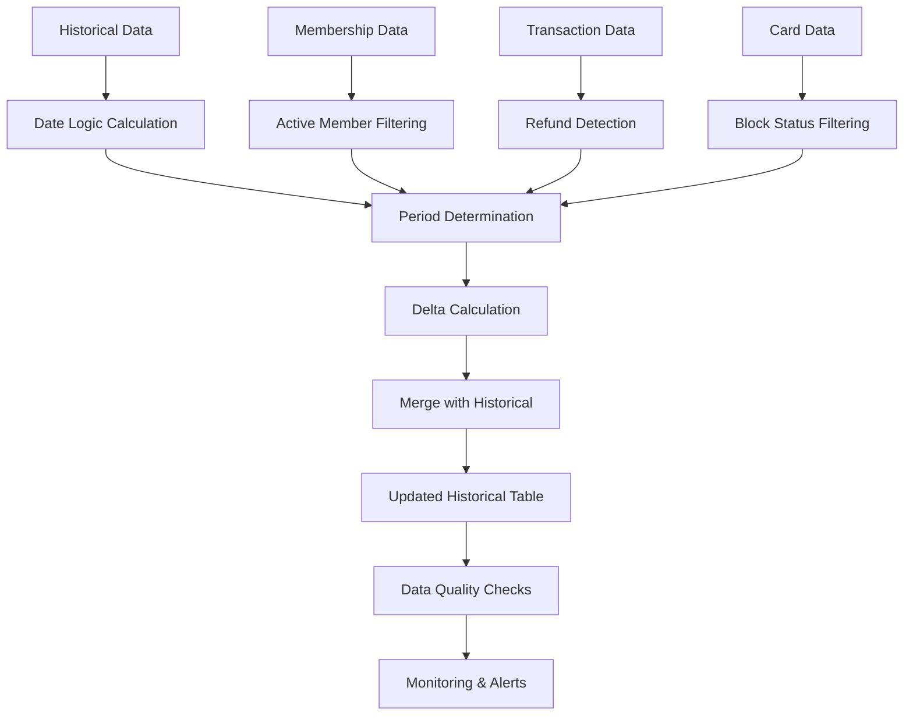

# Snowflake Recursive ETL Implementation Guide
## PROD_active_base_history ETL System

This guide provides a comprehensive implementation of a recursive ETL system in Snowflake for maintaining the `PROD_active_base_history` dataset.

## 📋 Overview

The ETL system consists of:
- **Historical Table**: `DOMO.WRITEBACK."PROD_active_base_history"`
- **Delta Processing**: Real-time calculation from membership data
- **Merge Logic**: Upsert operations to maintain historical records
- **Automated Scheduling**: Snowflake tasks for regular execution
- **Monitoring & Alerting**: Comprehensive logging and health checks

## 🚀 Setup Instructions

### 1. Prerequisites

Ensure you have the following permissions in Snowflake:
- `CREATE TABLE` on `DOMO.WRITEBACK` schema
- `CREATE PROCEDURE` on `DOMO.WRITEBACK` schema
- `CREATE TASK` privilege
- `CREATE WAREHOUSE` privilege (if creating new warehouse)

### 2. Initial Setup

Execute the scripts in this order:

```sql
-- 1. Run the main ETL procedure script
@snowflake_recursive_etl.sql

-- 2. Set up scheduling tasks
@snowflake_etl_scheduling.sql

-- 3. Create monitoring views and procedures
@snowflake_etl_monitoring.sql
```

### 3. Grant Necessary Permissions

```sql
-- Grant execute permissions on procedures
GRANT USAGE ON PROCEDURE DOMO.WRITEBACK.SP_REFRESH_PROD_ACTIVE_BASE_HISTORY() TO ROLE YOUR_ETL_ROLE;
GRANT USAGE ON PROCEDURE DOMO.WRITEBACK.SP_CHECK_ETL_HEALTH() TO ROLE YOUR_MONITORING_ROLE;
GRANT USAGE ON PROCEDURE DOMO.WRITEBACK.SP_BACKUP_ACTIVE_BASE_HISTORY() TO ROLE YOUR_ADMIN_ROLE;

-- Grant warehouse usage for tasks
GRANT USAGE ON WAREHOUSE ETL_WAREHOUSE TO ROLE YOUR_ETL_ROLE;
```

## 🔧 Configuration Options

### Scheduling Options

1. **Daily ETL (Recommended)**:
   ```sql
   ALTER TASK DOMO.WRITEBACK.TASK_REFRESH_ACTIVE_BASE_HISTORY RESUME;
   ```

2. **Conditional ETL** (only when source data changes):
   ```sql
   ALTER TASK DOMO.WRITEBACK.TASK_REFRESH_ACTIVE_BASE_HISTORY_CONDITIONAL RESUME;
   ```

3. **Month-end Processing**:
   ```sql
   ALTER TASK DOMO.WRITEBACK.TASK_REFRESH_ACTIVE_BASE_HISTORY_MONTH_END RESUME;
   ```

### Warehouse Sizing

Adjust warehouse size based on data volume:

```sql
-- For small datasets (< 1M records)
ALTER WAREHOUSE ETL_WAREHOUSE SET WAREHOUSE_SIZE = 'SMALL';

-- For medium datasets (1M - 10M records)
ALTER WAREHOUSE ETL_WAREHOUSE SET WAREHOUSE_SIZE = 'MEDIUM';

-- For large datasets (> 10M records)
ALTER WAREHOUSE ETL_WAREHOUSE SET WAREHOUSE_SIZE = 'LARGE';
```

## 🏃‍♂️ Manual Execution

### Run ETL Process Manually

```sql
-- Execute the main ETL procedure
CALL DOMO.WRITEBACK.SP_REFRESH_PROD_ACTIVE_BASE_HISTORY();
```

### Check ETL Health

```sql
-- Run health check
CALL DOMO.WRITEBACK.SP_CHECK_ETL_HEALTH();
```

### Create Backup

```sql
-- Create manual backup
CALL DOMO.WRITEBACK.SP_BACKUP_ACTIVE_BASE_HISTORY();
```

## 📊 Monitoring & Troubleshooting

### 1. Monitor ETL Execution

```sql
-- View recent ETL runs
SELECT * FROM DOMO.WRITEBACK.VW_ETL_RECENT_RUNS;

-- View execution summary by day
SELECT * FROM DOMO.WRITEBACK.VW_ETL_EXECUTION_SUMMARY;

-- Check data quality
SELECT * FROM DOMO.WRITEBACK.VW_ACTIVE_BASE_DATA_QUALITY;
```

### 2. Task Monitoring

```sql
-- Check task execution history
SELECT * 
FROM TABLE(INFORMATION_SCHEMA.TASK_HISTORY()) 
WHERE NAME LIKE '%ACTIVE_BASE_HISTORY%' 
ORDER BY SCHEDULED_TIME DESC;

-- Check task status
SHOW TASKS LIKE '%ACTIVE_BASE_HISTORY%';
```

### 3. Common Issues & Solutions

| Issue | Symptoms | Solution |
|-------|----------|----------|
| **Missing Source Data** | Zero records processed | Check source tables availability |
| **Date Logic Errors** | Incorrect fiscal year calculations | Verify calendar helper table |
| **Membership Filtering** | Incorrect active counts | Review filter criteria for EM accounts |
| **Performance Issues** | Long execution times | Scale up warehouse or optimize queries |

## 🔄 ETL Process Flow



## 📈 Performance Optimization

### 1. Indexing Strategy

```sql
-- Add clustering key for better performance
ALTER TABLE DOMO.WRITEBACK."PROD_active_base_history" 
CLUSTER BY ("fiscal_year", "home_business");
```

### 2. Optimize Source Queries

Consider creating materialized views for frequently accessed source data:

```sql
-- Example: Create materialized view for active memberships
CREATE MATERIALIZED VIEW DOMO.WRITEBACK.MV_ACTIVE_MEMBERSHIPS AS
SELECT *
FROM PSMT_LAKEHOUSE_DEV.AS400."PROD_membership_accounts"
WHERE "Account_Type" <> 'EM'
AND "Expiration_Date" >= CURRENT_DATE();
```

### 3. Parallel Processing

For large datasets, consider partitioning the ETL by business unit:

```sql
-- Process each business unit separately
CALL DOMO.WRITEBACK.SP_REFRESH_PROD_ACTIVE_BASE_HISTORY_BY_BUSINESS('001');
```

## 🔧 Maintenance Tasks

### Weekly Tasks
- Review ETL execution logs
- Check data quality metrics
- Verify task schedules

### Monthly Tasks
- Create full backup before month-end processing
- Review warehouse sizing and costs
- Clean up old backup tables

### Quarterly Tasks
- Review and optimize ETL performance
- Update monitoring thresholds
- Test disaster recovery procedures

## 📞 Support & Troubleshooting

### Log Analysis

```sql
-- Find recent errors
SELECT * 
FROM DOMO.WRITEBACK."PROD_active_base_history_log"
WHERE "status" = 'FAILED'
AND "run_timestamp" >= DATEADD(DAYS, -7, CURRENT_TIMESTAMP())
ORDER BY "run_timestamp" DESC;

-- Check performance trends
SELECT 
    DATE_TRUNC('WEEK', "run_timestamp") AS "week",
    AVG("execution_time_seconds") AS "avg_time",
    AVG("records_processed") AS "avg_records"
FROM DOMO.WRITEBACK."PROD_active_base_history_log"
WHERE "status" = 'SUCCESS'
GROUP BY DATE_TRUNC('WEEK', "run_timestamp")
ORDER BY "week" DESC;
```

### Emergency Procedures

1. **Stop All ETL Tasks**:
   ```sql
   ALTER TASK DOMO.WRITEBACK.TASK_REFRESH_ACTIVE_BASE_HISTORY SUSPEND;
   ALTER TASK DOMO.WRITEBACK.TASK_REFRESH_ACTIVE_BASE_HISTORY_CONDITIONAL SUSPEND;
   ALTER TASK DOMO.WRITEBACK.TASK_REFRESH_ACTIVE_BASE_HISTORY_MONTH_END SUSPEND;
   ```

2. **Restore from Backup**:
   ```sql
   -- Replace with actual backup table name
   CREATE OR REPLACE TABLE DOMO.WRITEBACK."PROD_active_base_history" AS
   SELECT * FROM DOMO.WRITEBACK."PROD_active_base_history_backup_YYYYMMDD_HHMMSS";
   ```

## 🎯 Best Practices

1. **Always test in development first**
2. **Monitor execution times and adjust warehouse sizing**
3. **Regular backup before major changes**
4. **Use version control for procedure changes**
5. **Document any customizations**
6. **Set up proper alerting for failures**

---

For additional support, consult the Snowflake documentation or contact your database administrator.